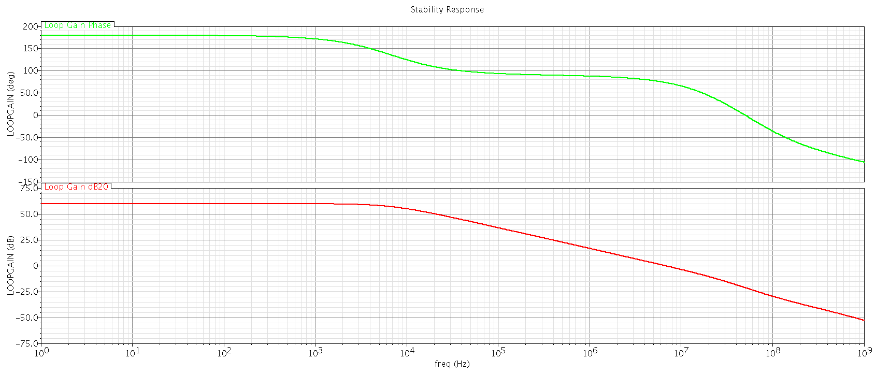
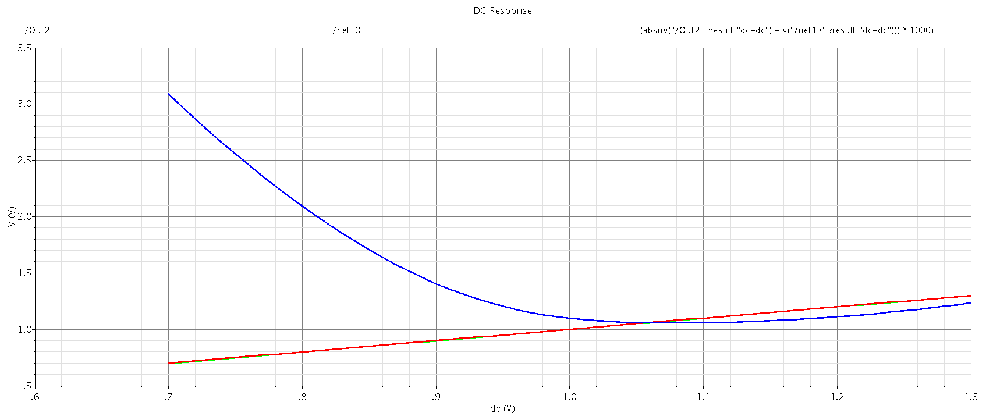
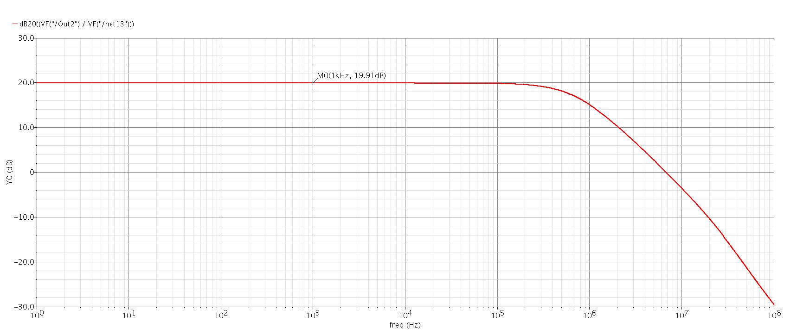

# THIẾT KẾ VÀ MÔ PHỎNG BỘ KHUẾCH ĐẠI THUẬT TOÁN CMOS HAI TẦNG TRÊN CÔNG NGHỆ TSMC 130 nm

## 1. Giới thiệu đề tài

Đề tài tập trung thiết kế và mô phỏng một bộ khuếch đại thuật toán CMOS hai tầng (Two-Stage Operational Amplifier) ở mức transistor. Mục tiêu là vận dụng kiến thức về cặp vi sai, gương dòng, phân cực MOSFET, hồi tiếp âm và bù tần số để xây dựng một mạch khuếch đại có độ lợi tương đối cao, ổn định khi mắc hồi tiếp và tiêu thụ công suất thấp.

Thiết kế được thực hiện trên Cadence Virtuoso 6.1.4 và mô phỏng bằng Spectre, sử dụng bộ model transistor thuộc PDK TSMC 130 nm RF. Phạm vi công việc gồm xây dựng schematic, thiết lập testbench, khảo sát DC, AC và transient, đồng thời đánh giá ảnh hưởng của nhiệt độ và biến thiên công nghệ. Dự án hiện dừng ở mức thiết kế và kiểm chứng trước layout; chưa chế tạo hoặc đo thử trên chip thực tế.

## 2. Yêu cầu và điều kiện thiết kế

Mạch hoạt động với điện áp nguồn 1,8 V và điện dung tải 5 pF. Ở điều kiện danh định TT, 27 °C, các mục tiêu sử dụng trong quá trình kiểm chứng là độ lợi tối thiểu 50 dB, băng thông unity-gain tối thiểu 5 MHz, phase margin tối thiểu 60°, độ dốc đáp ứng xung tối thiểu 5 V/µs và công suất tĩnh không vượt quá 500 µW. Trong đặc tả khởi đầu, mục tiêu độ lợi từng được đặt ở mức 40 dB; mức 50 dB là tiêu chí cao hơn được sử dụng khi đánh giá thiết kế cuối cùng.

Các transistor sử dụng model nch_25 và pch_25, thuộc nhóm MOS 2,5 V trong PDK. Điện áp cấp 1,8 V là lựa chọn vận hành của mạch, không phải tên công nghệ chế tạo. Tương tự, công nghệ 130 nm không có nghĩa chiều dài kênh của mọi transistor phải bằng 130 nm.

## 3. Kiến trúc mạch và lựa chọn linh kiện

Tầng đầu tiên là bộ khuếch đại vi sai NMOS gồm M0 và M1, sử dụng gương dòng PMOS M2 và M3 làm tải tích cực. Transistor M4 tạo dòng phân cực cho cặp vi sai. Tầng khuếch đại thứ hai sử dụng M5 (PMOS) và M6 (NMOS) để bổ sung độ lợi tại đầu ra. Tụ Miller có giá trị 2 pF được mắc để bù tần số, giúp cải thiện độ ổn định khi mạch làm việc với hồi tiếp âm.

Chiều dài kênh được chọn là 0,4 µm cho cả bảy transistor. Bề rộng lần lượt là 1 µm cho M0 và M1; 2,5 µm cho M2 và M3; 2 µm cho M4; 25 µm cho M5 và 10 µm cho M6. Điện áp phân cực danh định của M4 là 0,771 V. Việc sử dụng chiều dài kênh lớn hơn kích thước tối thiểu có thể hỗ trợ tăng điện trở đầu ra và độ lợi, nhưng phải đánh đổi với điện dung ký sinh, diện tích và tốc độ. Tương tự, lựa chọn kích thước M5, dòng phân cực và tụ bù đều ảnh hưởng đồng thời đến độ lợi, băng thông, phase margin và công suất.

Những giá trị trên là cấu hình cuối cùng đã được mô phỏng. Dự án chưa có bộ dữ liệu sweep đầy đủ để kết luận đây là tổ hợp kích thước và phân cực tối ưu.

## 4. Triển khai mô phỏng

Mạch được kiểm tra trong hai cấu hình hồi tiếp chính. Cấu hình thứ nhất là voltage follower, dùng để đo khả năng bám điện áp đầu vào, khảo sát điểm làm việc DC, độ ổn định và đáp ứng với tín hiệu lớn. Cấu hình thứ hai là bộ khuếch đại không đảo với điện trở hồi tiếp 90 kΩ và điện trở xuống mức tham chiếu 10 kΩ, cho hệ số khuếch đại lý tưởng bằng 10.

Tổng cộng có 16 bộ kết quả Spectre được lưu trong dự án. Trong đó, 13 bộ thuộc nhóm voltage follower, bao gồm STB, DC operating point, DC sweep, transient, khảo sát nhiệt độ và năm process corner TT, FF, SS, FS, SF. Ba bộ còn lại dành cho mạch khuếch đại không đảo, gồm transient, đáp ứng AC và phép đo méo hài tổng THD.

## 5. Kết quả mô phỏng tại điều kiện danh định

Tại TT và 27 °C, độ lợi vòng lặp ở tần số thấp đo bằng STB đạt 59,85 dB. Unity-gain bandwidth đạt 6,673 MHz và phase margin đạt 73,59°. Công suất tĩnh khoảng 274,57 µW. Các kết quả này đáp ứng bộ chỉ tiêu danh định đã đặt ra.

Trong cấu hình voltage follower, sai số điện áp lớn nhất khi quét đầu vào từ 0,7 V đến 1,3 V là khoảng 3,09 mV. Phép đo đáp ứng xung cho độ dốc trung bình trên khoảng 20–80% là 9,512 V/µs ở cạnh lên và 8,204 V/µs ở cạnh xuống (xét độ lớn). Hai con số này không được hiểu là đã chứng minh slew rate tức thời cực đại của mạch.

Ở cấu hình khuếch đại không đảo, hệ số khuếch đại đo bằng transient tại 10 kHz đạt khoảng 9,982 lần. Đáp ứng AC cho độ lợi khoảng 19,91 dB tại 10 kHz và băng thông giảm 3 dB vào khoảng 700,3 kHz. THD đo được xấp xỉ 0,01706% trong điều kiện nguồn sin 10 kHz, biên độ 10 mV. Đây là các kết quả ở mức schematic simulation, không phải số liệu đo trên silicon.

### Một số hình mô phỏng

Đáp ứng ổn định của mạch ở điều kiện TT:

Đặc tuyến sai số điện áp của mạch follower:

Đáp ứng độ lợi theo tần số của mạch khuếch đại không đảo:

Các hình còn lại, bao gồm điểm làm việc, slew rate, phase response, process corner và THD, được lưu trong thư mục TwoStage_CMOS_OpAmp/results_simulation.

## 6. Ảnh hưởng của nhiệt độ và biến thiên công nghệ

Khi nhiệt độ thay đổi từ 0 °C đến 70 °C trong cùng corner TT, độ lợi vòng lặp ở tần số thấp giảm từ khoảng 60,60 dB xuống 58,76 dB; unity-gain bandwidth giảm từ 6,733 MHz xuống 6,496 MHz. Trong cùng khoảng nhiệt độ, công suất tăng từ 251,17 µW lên 306,35 µW. Đây là xu hướng quan sát được ở cấu hình phân cực của mạch đang khảo sát.

Phân tích process corner cho thấy các đánh đổi rõ rệt. Tại FF và FS, unity-gain bandwidth lần lượt đạt khoảng 10,084 MHz và 9,006 MHz, nhưng công suất tăng lên 621,89 µW và 555,46 µW, vượt mức 500 µW. Tại SS và SF, công suất thấp hơn nhiều nhưng unity-gain bandwidth chỉ khoảng 3,025 MHz và 3,418 MHz, chưa đạt mục tiêu 5 MHz. Phase margin vẫn lớn hơn 60° ở cả năm corner được kiểm tra.

Do đó, có thể kết luận mạch đạt các chỉ tiêu chính ở điều kiện danh định, nhưng chưa đáp ứng đồng thời yêu cầu về tốc độ và công suất trên toàn bộ các corner. Kết quả process corner là cơ sở để xác định hạn chế của thiết kế, không phải bằng chứng hoàn tất kiểm chứng PVT để chế tạo.

## 7. Cấu trúc và cách sử dụng dữ liệu dự án

Thư mục TwoStage_CMOS_OpAmp/TwoStage_OpAmp_130nm chứa các cell schematic được xây dựng trong Cadence. Thư mục TwoStage_CMOS_OpAmp/sim_results lưu dữ liệu mô phỏng Spectre để xem lại kết quả. Thư mục TwoStage_CMOS_OpAmp/results_simulation lưu ảnh các phép đo. Các file trong cadence_corners phục vụ việc lựa chọn model cho quá trình khảo sát process corner.

Để mở lại thiết kế và tái lập mô phỏng, cần có phiên bản Cadence Virtuoso/Spectre tương thích cùng quyền truy cập hợp pháp vào PDK TSMC 130 nm. Các đường dẫn model và thư viện trong dự án được thiết lập theo máy gốc nên có thể cần điều chỉnh khi chuyển sang môi trường khác. Repository không bao gồm bộ PDK đầy đủ và không phải một môi trường mô phỏng độc lập có thể chạy ngay trên mọi máy tính.

## 8. Hạn chế và hướng phát triển

Dự án hiện chưa thực hiện physical layout, DRC, LVS, trích xuất ký sinh PEX hoặc post-layout simulation. Các thông số như CMRR, PSRR, input-referred noise, dải điện áp common-mode đầu vào, output swing và sai lệch do mismatch cũng chưa được kiểm chứng đầy đủ.

Nếu tiếp tục phát triển, hướng ưu tiên là khảo sát lại kích thước transistor, dòng phân cực và tụ bù để cải thiện băng thông ở SS/SF mà vẫn kiểm soát công suất tại FF/FS. Sau đó cần bổ sung các phép đo còn thiếu và đánh giá tác động của ký sinh sau layout.

## 9. Tài liệu tham khảo

J. T. Zhang (2021), *Two-Stage Operational Amplifier Design by Using Direct and Indirect Feedback Compensations*.

Tài liệu trên được sử dụng để tham khảo cơ sở lý thuyết về kiến trúc khuếch đại hai tầng và bù tần số. Thiết kế TSMC 130 nm cùng các kết quả mô phỏng trong repository thuộc dự án được triển khai riêng.
